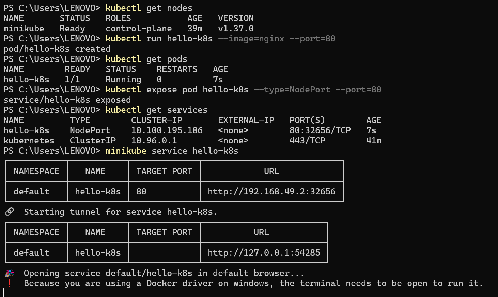
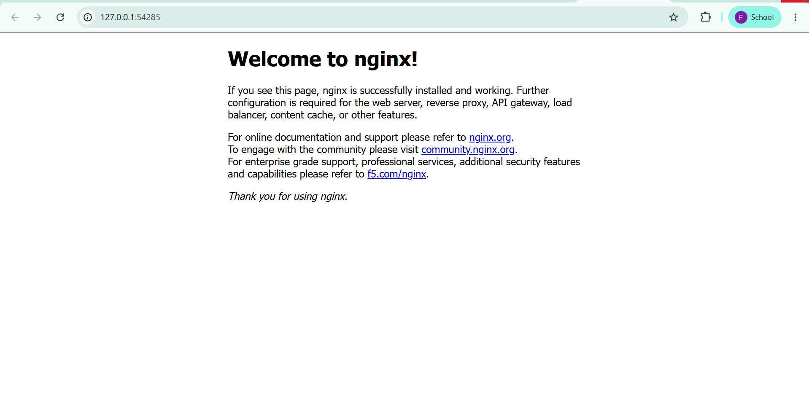

# Kubernetes Hands-On Exercise 1: Getting Started

## Business Problem (Zepto Example)

Imagine you are a **DevOps Engineer at Zepto**. The product team has developed a lightweight web application that displays the storefront and delivery status to customers. Kubernetes helps deploy and manage containerized applications reliably.

In this exercise, we will create a Kubernetes Pod running Nginx, expose it through a NodePort service, and access the application through a web browser using Minikube.

## Objectives

- Start a local Kubernetes cluster using Minikube.
- Create a Pod using the Nginx container image.
- Expose the Pod using a NodePort service.
- Access the application through a browser.
- Verify the status of the Kubernetes node, Pod, and service.

## Prerequisites

- Docker Desktop
- Minikube
- kubectl
- A web browser

## 1. Start Minikube

Start a local Kubernetes cluster using the Docker driver:

```powershell
minikube start --driver=docker
```

Check the cluster status:

```powershell
minikube status
```

## 2. Verify the Kubernetes Cluster

Check whether the Kubernetes node is ready:

```powershell
kubectl get nodes
```

The Minikube node should display `Ready` as its status.

## 3. Create Your First Pod (Using Nginx Image)

Create a Pod named `hello-k8s` using the Nginx image:

```powershell
kubectl run hello-k8s --image=nginx --port=80
```

Verify that the Pod is running:

```powershell
kubectl get pods
```

The Pod should eventually show `Running` with `1/1` containers ready.

## 4. Expose the Pod Using NodePort

Expose the Pod through a NodePort service so that the application can be accessed through Minikube:

```powershell
kubectl expose pod hello-k8s --type=NodePort --port=80
```

Verify that the service has been created:

```powershell
kubectl get services
```

The `hello-k8s` service should have the type `NodePort`.

## 5. Verify the Kubernetes Setup

The following screenshot shows the Kubernetes node status, Pod creation, service exposure, and the URL generated by Minikube.



## 6. Open the App in Your Browser

Run the following command to open the application:

```powershell
minikube service hello-k8s
```

You should see the Nginx welcome page. Congratulations, you have deployed your first container in Kubernetes!



## Troubleshooting Notes

- **Minikube is not running:** Start the cluster using `minikube start --driver=docker`.
- **Pod is not ready:** Check its status using `kubectl get pods` and wait for the container to finish starting.
- **Service is not accessible:** Verify the service using `kubectl get services`.
- **Local URL stops working:** When using the Docker driver on Windows, keep the terminal running `minikube service hello-k8s` open while accessing the application.

## Result

Successfully started a local Kubernetes cluster, created a standalone Pod using the Nginx image, exposed the Pod using a NodePort service, and accessed the Nginx welcome page through a web browser.