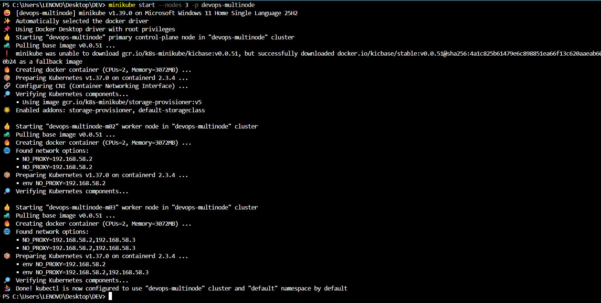
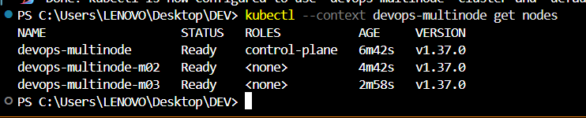
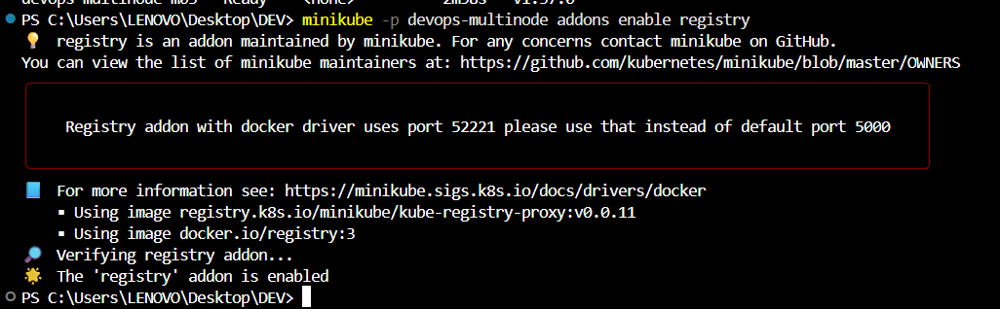
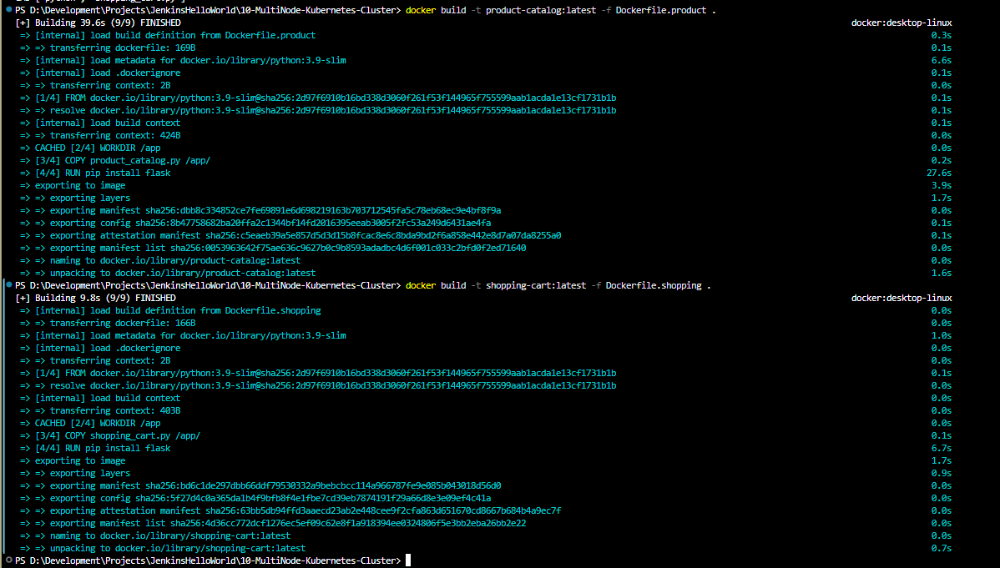
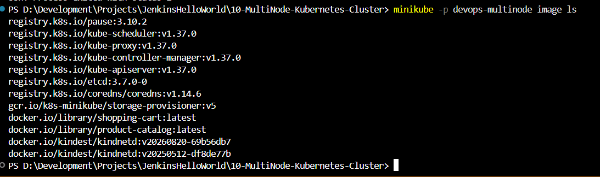
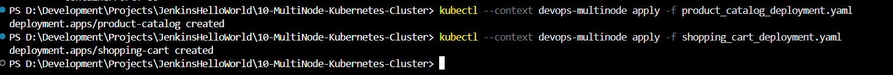
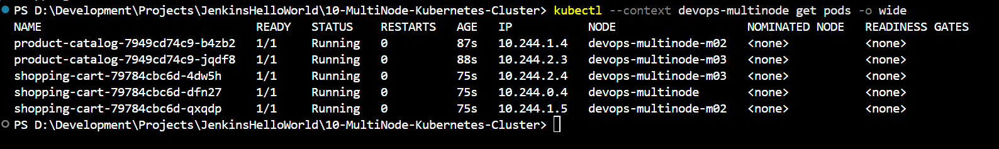
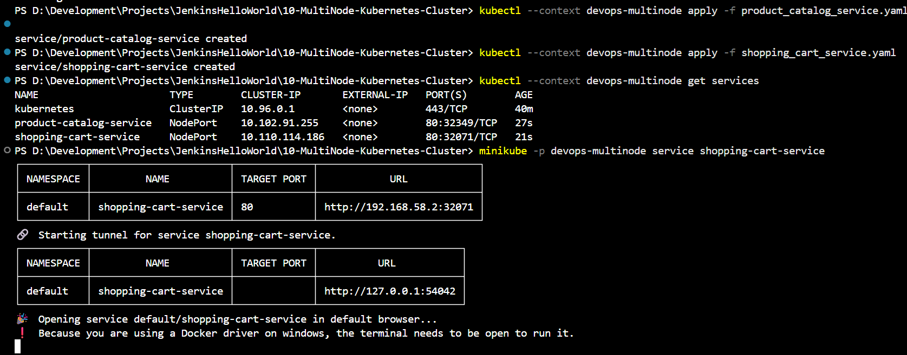
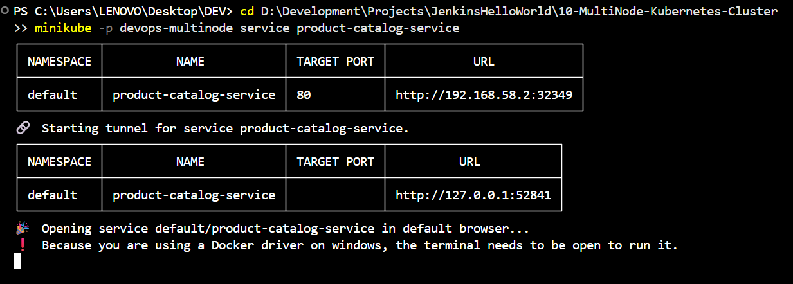
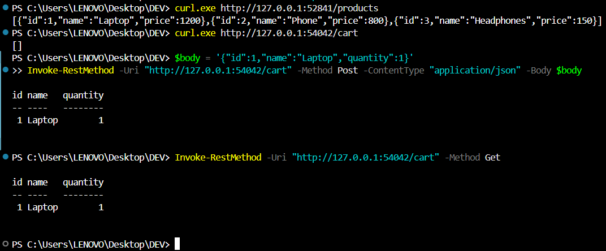

# Exercise 10: Multi-Node Kubernetes Cluster with Multiple Applications and ReplicaSets

## Storyboard

Building an e-commerce platform with two services:

1. **Product Catalog (AppA)** — provides information about available products.
2. **Shopping Cart (AppB)** — manages user shopping carts.

For availability and fault tolerance, Product Catalog runs 2 replicas and Shopping Cart runs 3 replicas, with pod anti-affinity rules ensuring each replica lands on a different node.

## Use Case

An online store needs high availability for critical services like product browsing and cart management. Distributing replicas across multiple nodes means that even if one node fails, the services remain available to customers.

## Step 1: Clean up and start a 3-node Minikube cluster

```powershell
minikube start --nodes 3 -p devops-multinode
```



## Step 2: Verify all three nodes are Ready

```powershell
kubectl --context devops-multinode get nodes
```

All three nodes were verified as `Ready`: the control-plane node and two worker nodes.



## Step 3: Enable the registry addon

```powershell
minikube -p devops-multinode addons enable registry
```

The registry addon was enabled successfully.



## Step 4: Product Catalog (AppA) — Flask app

`product_catalog.py`

```python
from flask import Flask, jsonify

app = Flask(__name__)

products = [
    {"id": 1, "name": "Laptop", "price": 1200},
    {"id": 2, "name": "Phone", "price": 800},
    {"id": 3, "name": "Headphones", "price": 150},
]

@app.route("/products", methods=["GET"])
def get_products():
    return jsonify(products)

if __name__ == "__main__":
    app.run(host="0.0.0.0", port=80)
```

## Step 5: Shopping Cart (AppB) — Flask app

`shopping_cart.py`

```python
from flask import Flask, jsonify, request

app = Flask(__name__)

cart = []

@app.route("/cart", methods=["GET"])
def get_cart():
    return jsonify(cart)

@app.route("/cart", methods=["POST"])
def add_to_cart():
    item = request.json
    cart.append(item)
    return jsonify(cart), 201

if __name__ == "__main__":
    app.run(host="0.0.0.0", port=80)
```

## Step 6: Dockerize both applications

`Dockerfile.product`

```dockerfile
FROM python:3.9-slim
WORKDIR /app
COPY product_catalog.py /app/
RUN pip install flask
CMD ["python", "product_catalog.py"]
```

`Dockerfile.shopping`

```dockerfile
FROM python:3.9-slim
WORKDIR /app
COPY shopping_cart.py /app/
RUN pip install flask
CMD ["python", "shopping_cart.py"]
```

Build both images:

```powershell
docker build -t product-catalog:latest -f Dockerfile.product .
docker build -t shopping-cart:latest -f Dockerfile.shopping .
```



## Step 7: Load images into the cluster

```powershell
minikube -p devops-multinode image load product-catalog:latest
minikube -p devops-multinode image load shopping-cart:latest
```

Verify the images:

```powershell
minikube -p devops-multinode image ls
```



## Step 8: Deploy with pod anti-affinity

`product_catalog_deployment.yaml` — 2 replicas, required anti-affinity on `app: product-catalog`.

`shopping_cart_deployment.yaml` — 3 replicas, required anti-affinity on `app: shopping-cart`.

Both deployments use `requiredDuringSchedulingIgnoredDuringExecution` pod anti-affinity with `topologyKey: "kubernetes.io/hostname"`, which forces the Kubernetes scheduler to place replicas of the same app on different nodes rather than allowing it as a soft preference.

Apply both deployments:

```powershell
kubectl --context devops-multinode apply -f product_catalog_deployment.yaml
kubectl --context devops-multinode apply -f shopping_cart_deployment.yaml
```



## Step 9: Expose services and verify pod distribution

`product_catalog_service.yaml` and `shopping_cart_service.yaml` — both `NodePort` services on port 80.

Apply both services:

```powershell
kubectl --context devops-multinode apply -f product_catalog_service.yaml
kubectl --context devops-multinode apply -f shopping_cart_service.yaml
```

Verify pod distribution:

```powershell
kubectl --context devops-multinode get pods -o wide
```

The anti-affinity rules worked as intended:

- **Product Catalog (2 pods):** one on `devops-multinode-m02`, one on `devops-multinode-m03`.
- **Shopping Cart (3 pods):** one on `devops-multinode-m02`, one on `devops-multinode-m03`, and one on the control-plane node `devops-multinode`.

No two replicas of the same service share a node.



## Step 10: Access and test both services

Access the Shopping Cart service:

```powershell
minikube -p devops-multinode service shopping-cart-service
```



Access the Product Catalog service:

```powershell
minikube -p devops-multinode service product-catalog-service
```



### Test Product Catalog

```powershell
curl.exe http://127.0.0.1:52841/products
```

Expected response:

```json
[{"id":1,"name":"Laptop","price":1200},{"id":2,"name":"Phone","price":800},{"id":3,"name":"Headphones","price":150}]
```

### Test Shopping Cart

```powershell
curl.exe http://127.0.0.1:54042/cart
```

Initial response:

```json
[]
```

Add a product to the cart using PowerShell:

```powershell
$body = '{"id":1,"name":"Laptop","quantity":1}'
Invoke-RestMethod -Uri "http://127.0.0.1:54042/cart" -Method Post -ContentType "application/json" -Body $body
```

Verify the cart:

```powershell
Invoke-RestMethod -Uri "http://127.0.0.1:54042/cart" -Method Get
```



## Summary

Deployed two Python Flask applications on a 3-node Minikube cluster with ReplicaSets, using pod anti-affinity to guarantee each replica runs on a distinct node. This maximizes availability and fault tolerance: a single node failure would not take down an entire service, since replicas are deliberately spread across the cluster.

## Key Takeaways

- `requiredDuringSchedulingIgnoredDuringExecution` pod anti-affinity is a hard constraint — the scheduler will leave a pod `Pending` rather than violate it, unlike the `preferred` variant, which is a soft hint.
- A multi-node local cluster has more moving parts than a single-node cluster: worker nodes can briefly report `NotReady` while CNI networking initializes.
- `minikube image load` loads locally built images into the cluster nodes.
- Namespace consistency across related manifests matters: a mismatched `namespace` field between a Deployment and its dependencies can cause deployment failures.
