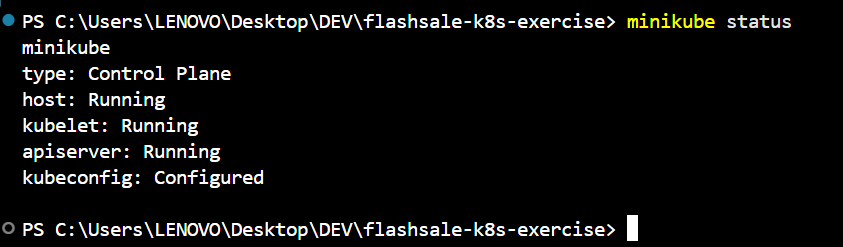
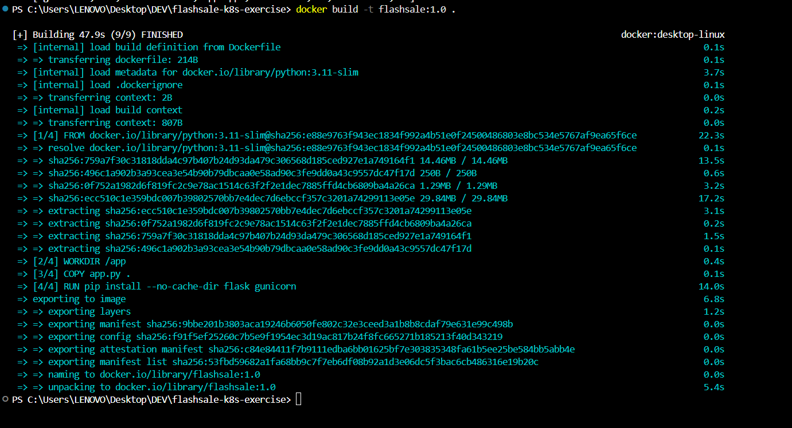
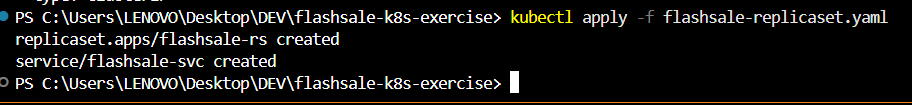
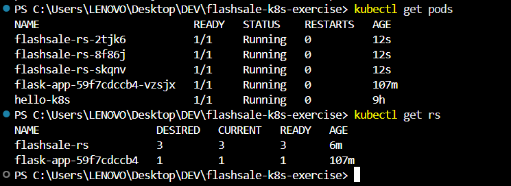
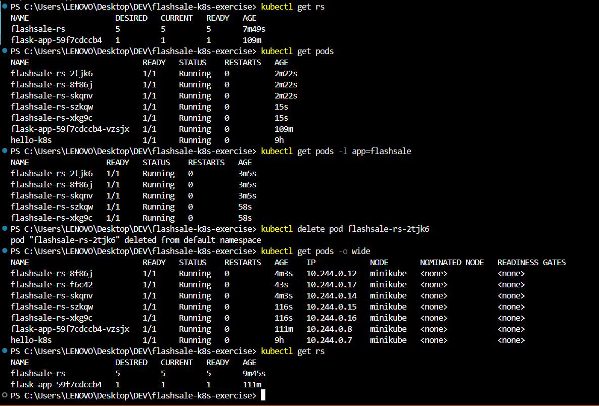

# Exercise 3: Scaling a Flask App Using ReplicaSets

## Real-Life Use Case: E-commerce Flash Sale

During a flash sale (e.g. Big Billion Days, Prime Day), traffic can spike from ~100 requests/minute to 10,000+ requests/minute. A single Pod would crash under this load. ReplicaSets let Kubernetes scale out to many identical Pods to distribute traffic, then scale back down once demand drops.

## Objective

- Understand ReplicaSets and Pods
- Scale a Flask app deployment
- Observe pod distribution and self-healing

## App: Flash Sale Checkout Service

```python
from flask import Flask, request
import socket
import time
import random

app = Flask(__name__)

@app.get("/")
def homepage():
    return {
        "message": "Welcome to Big Sale!",
        "pod": socket.gethostname(),
        "ts": time.time()
    }

@app.get("/buy")
def buy():
    item = random.choice(["Smartphone", "Shoes", "Headphones", "Laptop"])
    user = request.args.get("user", f"user{random.randint(1, 1000)}")
    return {
        "status": "success",
        "item": item,
        "user": user,
        "served_by_pod": socket.gethostname(),
        "time": time.strftime("%H:%M:%S")
    }

@app.get("/health")
def health():
    return {
        "status": "healthy",
        "pod": socket.gethostname()
    }
```

## Dockerfile

```dockerfile
FROM python:3.11-slim
WORKDIR /app
COPY app.py .
RUN pip install --no-cache-dir flask gunicorn
CMD ["gunicorn","-b","0.0.0.0:5000","app:app","--workers","1","--threads","2"]
```

## Step 1: Confirm Minikube is running

```powershell
minikube status
```



Minikube host, kubelet, and API server were running.

## Step 2: Build the image into Minikube

On Windows, the Minikube Docker environment command was not compatible with the current containerd setup. The image was therefore built using Docker Desktop and loaded into Minikube.

```powershell
docker build -t flashsale:1.0 .
minikube image load flashsale:1.0
minikube image ls
```



The image `docker.io/library/flashsale:1.0` was available in Minikube.

## Step 3: ReplicaSet + Service YAML

File: `flashsale-k8s-exercise/flashsale-replicaset.yaml`

```yaml
apiVersion: apps/v1
kind: ReplicaSet
metadata:
  name: flashsale-rs
  labels:
    app: flashsale
spec:
  replicas: 3
  selector:
    matchLabels:
      app: flashsale
  template:
    metadata:
      labels:
        app: flashsale
    spec:
      containers:
      - name: flashsale-container
        image: flashsale:1.0
        imagePullPolicy: Never
        ports:
        - containerPort: 5000
        readinessProbe:
          httpGet:
            path: /health
            port: 5000
          initialDelaySeconds: 2
          periodSeconds: 5
        livenessProbe:
          httpGet:
            path: /health
            port: 5000
          initialDelaySeconds: 10
          periodSeconds: 10
        resources:
          requests:
            cpu: "100m"
            memory: "128Mi"
          limits:
            cpu: "500m"
            memory: "256Mi"
---
apiVersion: v1
kind: Service
metadata:
  name: flashsale-svc
spec:
  selector:
    app: flashsale
  ports:
  - name: http
    port: 80
    targetPort: 5000
  type: ClusterIP
```

## Step 4: Apply the ReplicaSet

```powershell
kubectl apply -f flashsale-replicaset.yaml
```



Output:

```text
replicaset.apps/flashsale-rs created
service/flashsale-svc created
```

## Step 5: Verify initial Pods and ReplicaSet

```powershell
kubectl get pods
kubectl get rs
```



Three Flash Sale Pods came up, all `Running`. The ReplicaSet showed 3 desired, 3 current, and 3 ready replicas.

## Step 6: Scale up to 5 replicas

```powershell
kubectl scale rs flashsale-rs --replicas=5
kubectl get rs
kubectl get pods
```

The ReplicaSet scaled from 3 to 5 replicas. All five Flash Sale Pods reached `Running` status, and the ReplicaSet showed 5 desired, 5 current, and 5 ready replicas.

## Step 7: Delete a Pod and observe self-healing

```powershell
kubectl delete pod flashsale-rs-2tjk6
kubectl get pods -o wide
kubectl get rs
```



Kubernetes replaced the deleted Pod to maintain the desired replica count. The replacement Pod was `flashsale-rs-f6c42`. All five Flash Sale Pods were running on the single Minikube node (`minikube`), each with a unique internal IP.

## Key Observations

- **Pod Distribution** — each Pod is an identical worker; scaling creates clones of the app.
- **Resiliency** — deleting a Pod triggers automatic replacement, so the desired replica count is maintained.
- **Efficiency** — scaling changes the number of running Pods to meet the desired replica count.
- **Real-World Parallel** — ReplicaSets help maintain multiple instances of an application during periods of high demand.

## Q&A

**Q1: What is the initial number of replicas?**  
A: 3

**Q2: What happens when scaling to 5 replicas?**  
A: Kubernetes creates 2 additional Pods to reach the desired count of 5.

**Q3: What happens when a Pod is deleted?**  
A: Kubernetes automatically creates a new Pod to replace it, maintaining the desired replica count.

**Q4: How does Kubernetes maintain the desired replica count?**  
A: It continuously compares the actual number of Pods with the desired count and creates or deletes Pods to reconcile any difference.

**Q5: How many nodes were used?**  
A: 1 (single-node Minikube cluster); all Pods were scheduled on the same node.
