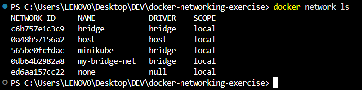
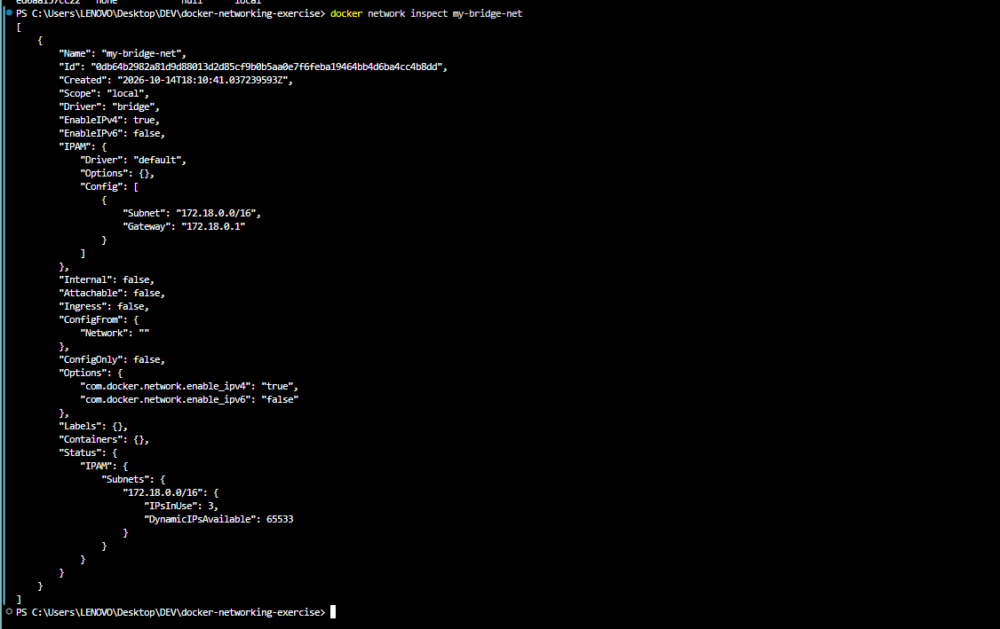
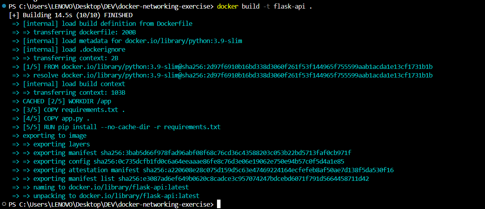
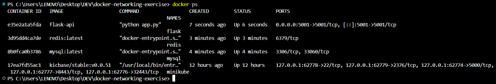
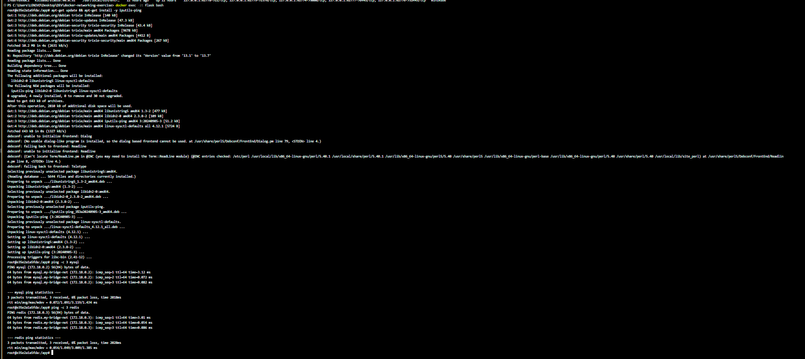
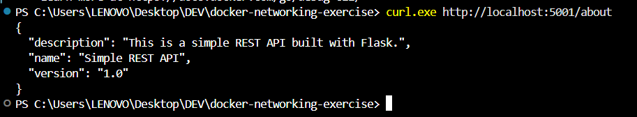

# Exercise 4: Docker Networking with Multiple Containers

## Objective

Understand Docker networking concepts and configure a multi-container application where services communicate over a custom bridge network.

## Scenario

A web application composed of three containers:

- A Python Flask web server

- A MySQL database

- A Redis cache

## Step 1: Create a bridge network

```bash

docker network create --driver bridge my-bridge-net

```

## Step 2: Verify the network

```bash

docker network ls

```



## Step 3: Inspect the network

```bash

docker network inspect my-bridge-net

```



## Step 4: Flask app

**app.py**

```python

from flask import Flask, jsonify

app = Flask(__name__)

@app.route('/about', methods=['GET'])

def about():

    return jsonify({

        "name": "Simple REST API",

        "version": "1.0",

        "description": "This is a simple REST API built with Flask."

    })

if __name__ == '__main__':

    app.run(debug=True, host='0.0.0.0', port=5001)

```

**requirements.txt**

```text

Flask==2.0.1

Werkzeug==2.0.3

```

**Dockerfile**

```dockerfile

FROM python:3.9-slim

WORKDIR /app

COPY requirements.txt .

COPY app.py .

RUN pip install --no-cache-dir -r requirements.txt

EXPOSE 5001

CMD ["python", "app.py"]

```

## Step 5: Build the Flask image

```bash

docker build -t flask-api .

```



## Step 6: Launch all three containers on the bridge network

```bash

docker run -d --name mysql --net=my-bridge-net -e MYSQL_ROOT_PASSWORD=rootpass mysql:latest

docker run -d --name redis --net=my-bridge-net redis:latest

docker run -d --name flask --net=my-bridge-net -p 5001:5001 flask-api

docker ps

```



Note: MySQL requires the root password environment variable.

## Step 7: Test connectivity between containers

Enter the Flask container:

```bash

docker exec -it flask bash

```

Install the ping utility inside the container:

```bash

apt-get update && apt-get install -y iputils-ping

```

Test connectivity:

```bash

ping -c 3 mysql

ping -c 3 redis

```



Both containers responded, confirming that they can resolve each other by name and communicate over the bridge network.

## Step 8: Test the Flask API from the host

```bash

curl.exe http://localhost:5001/about

```



Expected JSON:

```json

{

  "description": "This is a simple REST API built with Flask.",

  "name": "Simple REST API",

  "version": "1.0"

}

```

## Step 9: Clean up

After completing the screenshots and verification, the containers and network can be removed:

```bash

docker stop mysql redis flask

docker rm mysql redis flask

docker network rm my-bridge-net

```

## Q&A

**Q1: What is the purpose of the `--net` flag in `docker run`?**

It specifies which Docker network the container should connect to.

**Q2: How do containers communicate with each other on the same network?**

Containers on the same user-defined bridge network can resolve each other by name via Docker's built-in DNS and communicate over internal IP addresses.

**Q3: What is the difference between bridge network and host network?**

A bridge network isolates containers on a private virtual network, requiring explicit port mapping to reach services from outside. Host networking shares the host network stack directly, without the same network isolation.

**Q4: How do you expose a container's port to the host machine?**

Use `-p`, for example `-p 5001:5001`, to map a host port to a container port.


