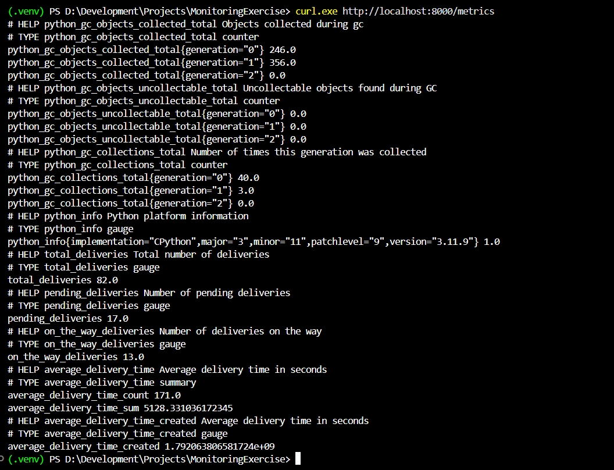
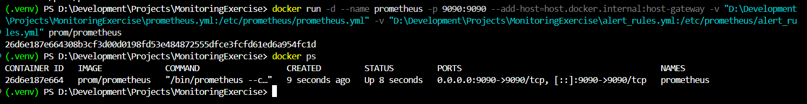
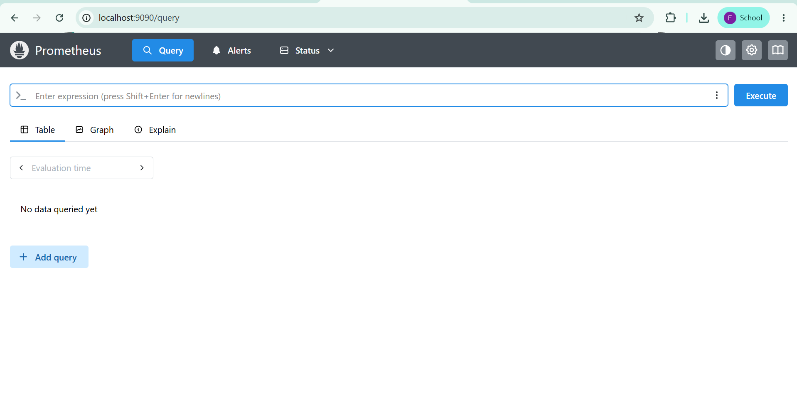
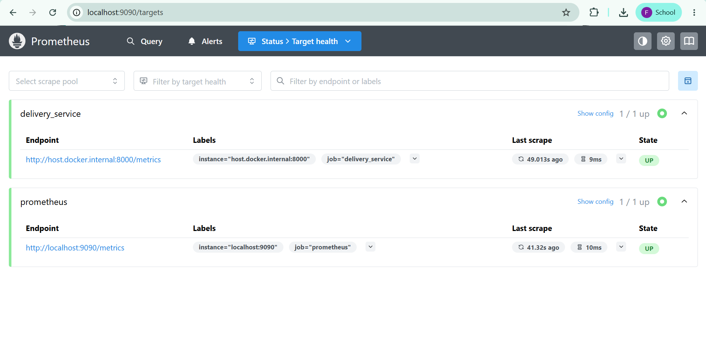
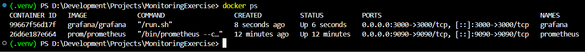
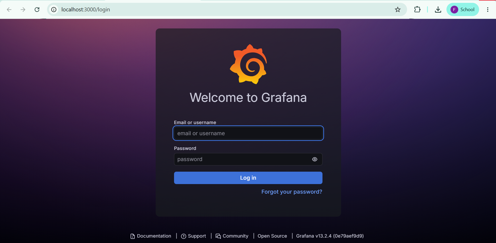
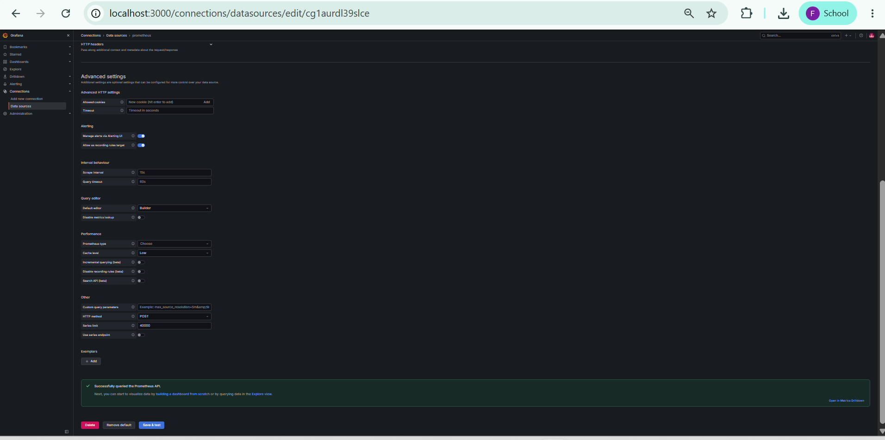
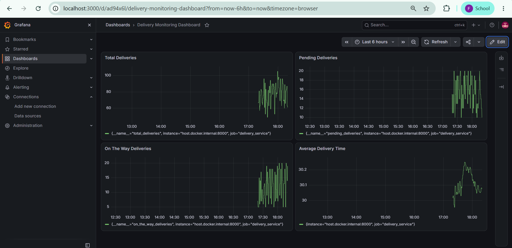
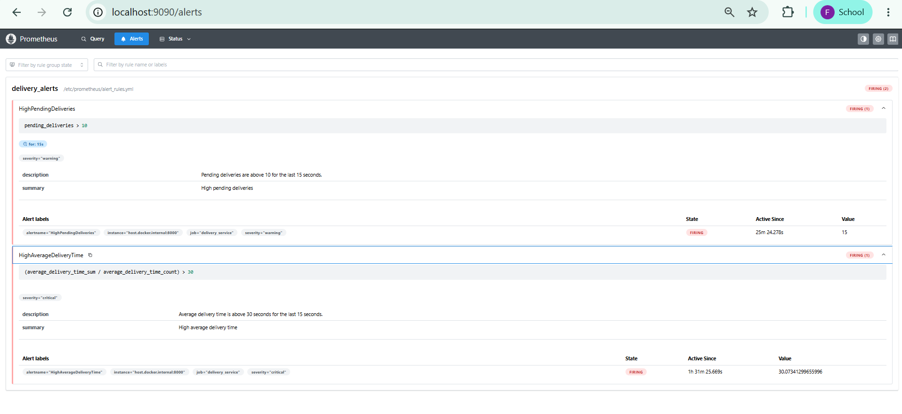

# Exercise 6: Real-Time Operations Monitoring and Alerting

## Objective

Build a monitoring pipeline for a simulated delivery service, using Python to generate live metrics, Prometheus to scrape and alert on them, and Grafana to visualize them on a dashboard.

## Scenario

As a DevOps engineer at a delivery service, create a pipeline that simulates delivery metrics, visualizes them on dashboards, and sets up automated alerts to catch operational issues in real time.

## Step 1: Install the Python package

```powershell
python -m pip install prometheus-client
```

## Step 2: Create the metrics simulation script

The `delivery_metrics.py` script generates delivery metrics and exposes them on port `8000`.

```python
from prometheus_client import start_http_server, Summary, Gauge
import random
import time

total_deliveries = Gauge("total_deliveries", "Total number of deliveries")
pending_deliveries = Gauge("pending_deliveries", "Number of pending deliveries")
on_the_way_deliveries = Gauge("on_the_way_deliveries", "Number of deliveries on the way")
average_delivery_time = Summary("average_delivery_time", "Average delivery time in seconds")

def simulate_delivery():
    pending = random.randint(10, 20)
    on_the_way = random.randint(5, 20)
    delivered = random.randint(30, 70)
    avg_time = random.uniform(15, 45)

    total = pending + on_the_way + delivered

    total_deliveries.set(total)
    pending_deliveries.set(pending)
    on_the_way_deliveries.set(on_the_way)
    average_delivery_time.observe(avg_time)

if __name__ == "__main__":
    start_http_server(8000, addr="0.0.0.0")
    while True:
        simulate_delivery()
        time.sleep(1)
```

Run the script from the repository root using the activated Python virtual environment:

```powershell
python .\monitoring-exercise\delivery_metrics.py
```

## Step 3: Verify the metrics endpoint

Open another PowerShell terminal and run:

```powershell
curl.exe http://localhost:8000/metrics
```

The endpoint exposes the custom delivery metrics alongside Python process metrics.



## Step 4: Configure Prometheus

Create `prometheus.yml` with the following configuration:

```yaml
scrape_configs:
  - job_name: "prometheus"
    static_configs:
      - targets: ["localhost:9090"]

  - job_name: "delivery_service"
    static_configs:
      - targets: ["host.docker.internal:8000"]

rule_files:
  - /etc/prometheus/alert_rules.yml
```

## Step 5: Configure alert rules

Create `alert_rules.yml`:

```yaml
groups:
  - name: delivery_alerts
    rules:
      - alert: HighPendingDeliveries
        expr: pending_deliveries > 10
        for: 15s
        labels:
          severity: warning
        annotations:
          summary: "High pending deliveries"
          description: "Pending deliveries are above 10 for the last 15 seconds."

      - alert: HighAverageDeliveryTime
        expr: (average_delivery_time_sum / average_delivery_time_count) > 30
        labels:
          severity: critical
        annotations:
          summary: "High average delivery time"
          description: "Average delivery time is above 30 seconds."
```

## Step 6: Run Prometheus

Run this command from the repository root in PowerShell. The configuration files are stored in `monitoring-exercise`.

```powershell
docker run -d --name prometheus -p 9090:9090 --add-host=host.docker.internal:host-gateway -v "${PWD}\monitoring-exercise\prometheus.yml:/etc/prometheus/prometheus.yml" -v "${PWD}\monitoring-exercise\alert_rules.yml:/etc/prometheus/alert_rules.yml" prom/prometheus
```



Access Prometheus at `http://localhost:9090`.



## Step 7: Verify Prometheus targets

Open **Status → Targets** in Prometheus. Both targets should show as UP.



## Step 8: Run Grafana

```powershell
docker run -d --name grafana -p 3000:3000 --add-host=host.docker.internal:host-gateway grafana/grafana
```



Open `http://localhost:3000` and log in with `admin` / `admin`.



## Step 9: Add Prometheus as a Grafana data source

In Grafana, go to **Connections → Data sources → Add data source → Prometheus**.

Set the Prometheus server URL to:

`http://host.docker.internal:9090`

Click **Save & test**.



## Step 10: Build the dashboard

Create a dashboard named **Delivery Monitoring Dashboard** with four Time series panels.

| Panel | PromQL query |
|---|---|
| Total Deliveries | `total_deliveries` |
| Pending Deliveries | `pending_deliveries` |
| On The Way Deliveries | `on_the_way_deliveries` |
| Average Delivery Time | `average_delivery_time_sum / average_delivery_time_count` |



## Step 11: Verify alerts are firing

Open **Alerts** in Prometheus and verify the alert rules.



The alert rules identify pending deliveries above 10 and average delivery time above 30 seconds.

## Result

The monitoring pipeline uses Python to generate delivery metrics, Prometheus to scrape metrics and evaluate alert rules, and Grafana to visualize the metrics in a four-panel dashboard.


