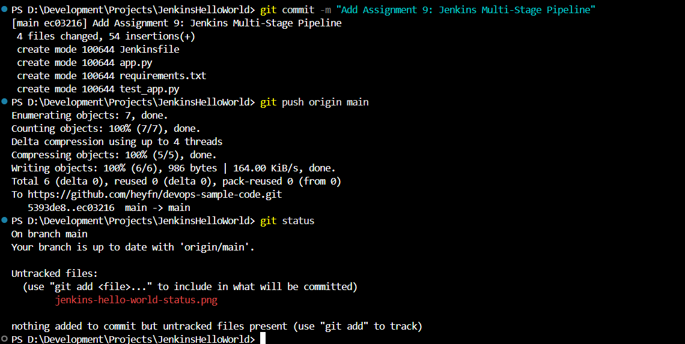
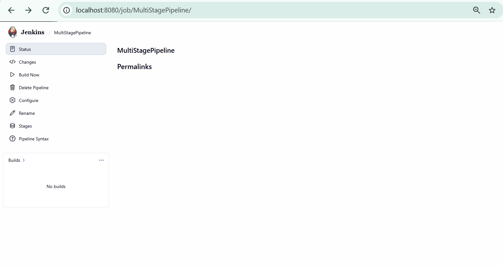
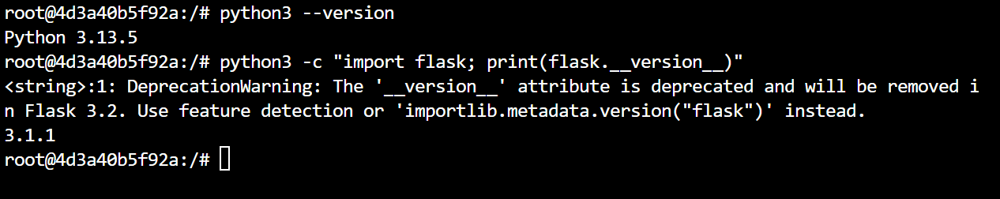
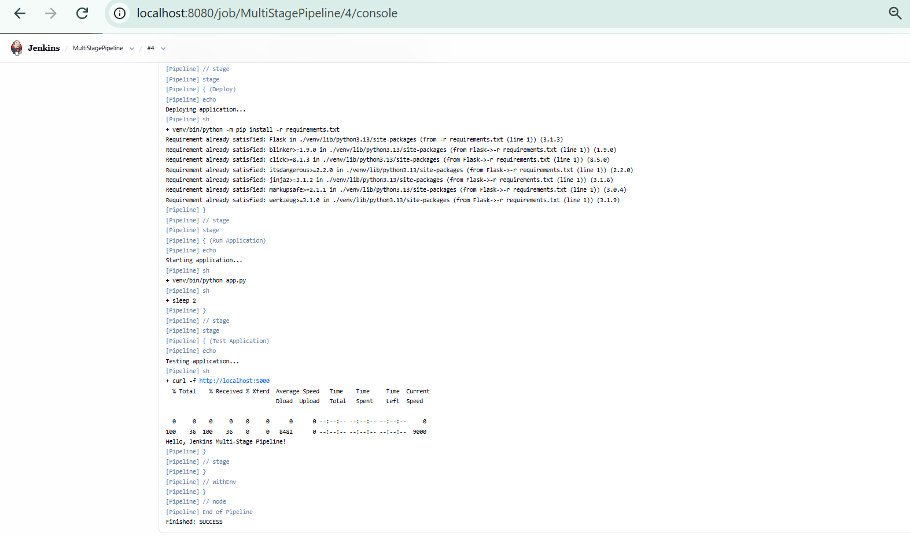

# Assignment 9: Jenkins Multi-Stage Pipeline

## Objective

To create a Jenkins multi-stage pipeline that automatically tests, deploys, runs, and verifies a Python Flask application using a Jenkinsfile stored in GitHub.

## Tools and Technologies

- Jenkins
- Docker
- Git and GitHub
- Python 3
- Flask
- pytest
- Declarative Jenkins Pipeline

## Application Overview

A simple Python Flask application is used to demonstrate the Jenkins multi-stage pipeline. The application returns a message when accessed through the root URL.

**Expected Output**

    Hello, Jenkins Multi-Stage Pipeline!

## Implementation

### Step 1: Push Application Files to GitHub

Created the following files in the `devops-sample-code` GitHub repository:

- `app.py` — Contains the Flask application.
- `requirements.txt` — Specifies the Python dependencies.
- `test_app.py` — Contains the application test case.
- `Jenkinsfile` — Defines the pipeline stages.

The files were committed and pushed to the `main` branch.

### Step 2: Configure the Jenkins Pipeline

Created a Jenkins pipeline job named `MultiStagePipeline` and configured it to retrieve the Jenkinsfile from GitHub using Pipeline Script from SCM.

**Configuration Details**

- **SCM:** Git
- **Repository URL:** `https://github.com/heyfn/devops-sample-code.git`
- **Branch:** `*/main`
- **Script Path:** `Jenkinsfile`

### Step 3: Configure Python in the Jenkins Container

Installed Python 3, pip, the Python virtual environment package, and Flask in the Jenkins container. Verified that Python and Flask were installed successfully.

### Step 4: Execute the Multi-Stage Pipeline

The Jenkinsfile defines four stages to automate the application workflow.

**1. Test**

- Creates a Python virtual environment.
- Installs the required dependencies and pytest.
- Executes the test case in `test_app.py`.

**2. Deploy**

- Installs the application dependencies in the virtual environment.

**3. Run Application**

- Starts the Flask application in the background.
- Waits briefly for the application to start.

**4. Test Application**

- Uses `curl` to send a request to `http://localhost:5000`.
- Checks that the application responds successfully with the expected message.

## Result

The Jenkins multi-stage pipeline executed successfully. All four stages completed, and the application returned the expected response:

    Hello, Jenkins Multi-Stage Pipeline!

**Final Status: SUCCESS**